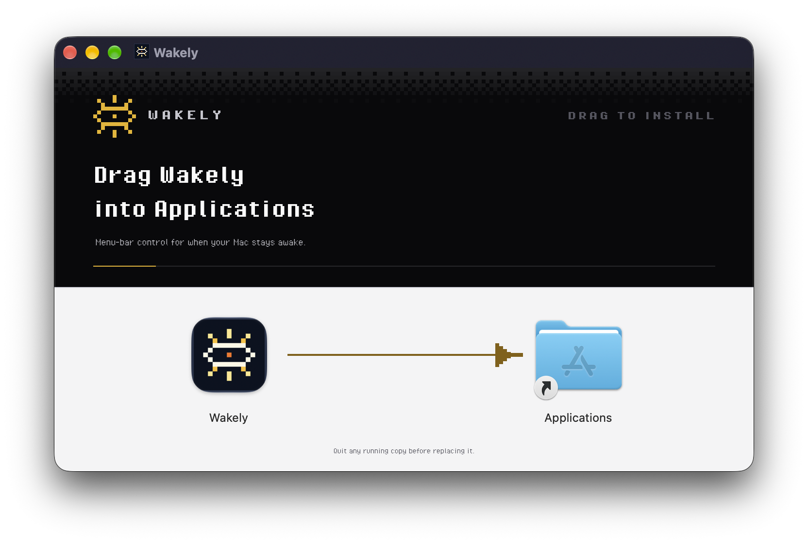

# Wakely

Wakely is a menu-bar app for macOS that decides when your Mac stays awake. It
can keep a MacBook running with the lid closed and no external display, so long
jobs, downloads and coding agents carry on while the screen is dark.

Everything runs locally. There is no account, no telemetry and no background
service unless you explicitly set up the optional helper for a component that
needs privileged access.

## What it does

- **Arm a closed-lid session.** The built-in display goes dark, the framebuffer
  stays live, and the Mac keeps working. Opening the lid or disarming ends the
  session and restores normal sleep.
- **Keep the Mac awake with the lid open.** Choose an indefinite or timed
  session from the menu.
- **Add components.** Thirty-one built-in behaviours cover agents, power,
  security, connections, keyboard shortcuts and scheduled sessions.
- **Build your own.** Describe a component or a whole screen to a coding agent;
  Wakely supplies the prompt, watches the folder and loads the result.
- **Learn by doing.** The guided tour highlights the real cards, inline
  controls, creation forms and menu instead of showing a separate slideshow.

## Requirements

- Apple Silicon Mac laptop (M1 or later)
- macOS 14 or later
- Command Line Tools (`swiftc`); Xcode is not required

## Build

```bash
./build.sh
open "build/Wakely.app"
```

`build.sh` compiles the app, helper, watchdog and component checker, assembles
and signs `build/Wakely.app`, and registers the `wakely://` URL scheme. Quit a
running development copy before rebuilding.

Signing is fail-closed. If a **Wakely Local Development** identity is configured,
the build uses it; otherwise it uses ad-hoc signing, whose privacy grants may
reset after a rebuild. The script never creates or unlocks a keychain and never
falls back from a configured identity to ad-hoc. See
[stable local signing](docs/local-signing.md) for setup, private-key handling and
distribution limits.

### Distribution build

```bash
WAKELY_SIGN_IDENTITY='Developer ID Application: YOUR NAME (TEAMID)' \
  WAKELY_DISTRIBUTION=1 ./build.sh
bash package-dmg.sh Wakely-2.0.0.dmg
```

Distribution mode enables the hardened runtime and timestamps. Packaging
verifies the existing bundle and stages a designed drag-to-Applications window
with a fixed Finder layout; it does not build, download, launch or change
privacy grants. Notarization is a
separate step:

```bash
xcrun notarytool submit dist/Wakely-2.0.0.dmg --wait
xcrun stapler staple dist/Wakely-2.0.0.dmg
```

Test the notarized image on a clean macOS account before publishing it.

## Install



1. Quit any running copy of Wakely.
2. Drag **Wakely.app** to Applications, or copy `build/Wakely.app` there for a
   local build.
3. Launch `/Applications/Wakely.app` and keep one installed copy with a stable
   signing identity.
4. Enable only the components you need. Wakely asks for Accessibility, Location,
   notifications or helper access at the point a component needs it.

Accessibility is required for Cleaning Lock and optional for Caps Lock typing
protection. Wi-Fi detection needs Location. Components that change protected
system settings share one helper installation, available from
**General → Privileged Helper**. Basic awake assertions need none of these
grants.

## Use

Click the menu-bar mark to arm or disarm Wakely, open Settings or quit. The menu
changes with the components you have enabled; disabled components do not add
rows.

URL commands:

```text
wakely://arm
wakely://disarm
wakely://toggle
wakely://status
wakely://settings?tab=components
wakely://importcomponent?path=/absolute/folder
wakely://removecomponent?id=<id>
```

Arm, then close the lid. The screen goes dark and the Mac keeps running. Open
the lid to end the session.

## Components

Every component is wired to real behaviour; none is a decorative toggle.

| Group | Components |
| --- | --- |
| Agents | Agent Screen, Agent Status, Finish Work Then Sleep, Agent Notifications, Agent Light, Sleep Until Reset |
| Keyboard | Caps Lock, Cleaning Lock, Lid-Close Sound, Quiet Close |
| Security | Password After Close, Bag Check |
| Power | Always On While Plugged In, Home Server, Low Power While Closed, Battery Budget, Keep Awake, Sleep Means Sleep, Stay Off When Opened, Finish Jobs Then Sleep, Sleep When Idle, Sleep Timer, Fan Boost, Eject on Sleep |
| Connections | Bluetooth Off While Closed, Awake While Connected, Lid Shortcuts, Arm While an App Runs, Arm on a Wi-Fi Network, Arm on a Schedule, Arm When a Drive Connects |

Five are on by default: Agent Screen, Agent Status, Lid-Close Sound, Caps Lock
and Always On While Plugged In. A few components change privileged settings
(fans, power policy, NVRAM, scheduled wakes, Touch ID policy); they say so on
their card and stay off until you set up the helper.

Safety is enforced in the engine: low battery while unplugged, serious or
critical thermal pressure, and quitting all disarm and release the power
assertions.

## Custom components

Open **Settings → Components → Make Your Own** and copy the prompt into Claude
Code, Codex, Cursor or another coding agent. The agent reads the installed kit,
writes `component.json` and `icon.txt`, and runs the bundled checker. The card
appears in the **Custom** group, off until you enable it.

```text
~/Library/Application Support/Wakely/Components/components/<id>/
```

The app watches that folder and reloads on change. Right-click a custom card to
edit it with your agent, reveal it in Finder or remove it. Invalid components
show their first validation error and a copyable fix prompt.

The SDK, schema and checker ship inside the app; the same kit is installed for
your agent on first launch.

## Custom screens

A screen is a full tab written as a small native SwiftUI bundle. From
**Components → Add a screen**, describe the page you want; Wakely gives your
agent the manifest format, build command and design rules. When the compiled
screen appears, Wakely validates it and adds the tab.

Each screen is one folder:

```text
~/Library/Application Support/Wakely/Screens/screens/<uuid>/
  screen.json
  Screen.swift
  Screen.dylib
```

Screens run in-process with the app's fonts and theme. They cannot import
Wakely's internal types, so the generation prompt includes self-contained
recipes for panels, buttons, switches and the adaptive palette.

## Privacy

- No analytics, accounts or network calls for normal operation.
- Components request access only when enabled, and opening a settings pane does
  not grant it.
- Diagnostics stay in `~/Library/Application Support/Wakely/diagnostics.log`
  and are copied only when you press **Copy**.
- Quitting releases power assertions and restores display brightness and any
  settings a component changed.

## Repository layout

```text
Sources/      app, engine, components, UI and custom-screen loader
Helper/       optional privileged helper
Watchdog/     crash-recovery watchdog
Resources/    icons, fonts, sounds, localizations and SDK kit
Tests/        policy, model, UI-safety and integration checks
docs/         signing, capability report and design notes
build.sh      compile, assemble and sign
```

## License

MIT. See [LICENSE](LICENSE). Bundled third-party resources remain the property
of their respective authors and are included for personal use.
