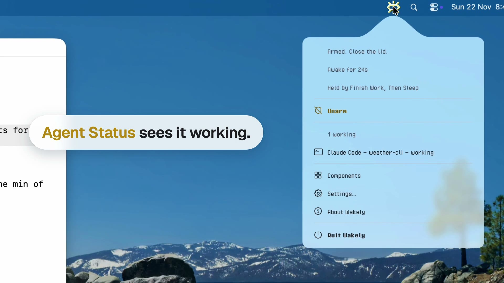

<div align="center">


# Wakely

**Keep your Mac awake. Close the lid. Keep working.**

A small native macOS menu-bar app that holds a closed-lid session without an
external display, so downloads, renders, builds and coding agents keep running
while the screen is dark.

[](#requirements)
[](#requirements)
[](LICENSE)
[](#components)

<p>
<a href="#install">Install</a> &nbsp;·&nbsp;
<a href="#components">Components</a> &nbsp;·&nbsp;
<a href="#custom-components">Custom components</a> &nbsp;·&nbsp;
<a href="#custom-screens">Custom screens</a> &nbsp;·&nbsp;
<a href="#build">Build</a> &nbsp;·&nbsp;
<a href="#privacy">Privacy</a>
</p>

</div>

<p align="center">
<a href="docs/wakely-launch.mp4"></a>
</p>

<p align="center">
<sub><b>Watch the launch video.</b> Arm from the menu bar, hand Claude Code a task, and Agent Status follows it while the lid is closed.</sub>
</p>

Wakely holds two macOS power assertions, darkens the built-in display on lid
close, and keeps the framebuffer live. Opening the lid or disarming ends the
session and restores normal sleep. Nothing leaves the Mac: no account, no
telemetry, no background service unless you opt into a privileged component.

## What it does

- **Arm a closed-lid session.** The built-in display goes dark while the Mac
  keeps working. No external display or dummy HDMI plug is needed.
- **Keep the Mac awake with the lid open.** Choose an indefinite or timed
  session from the menu bar.
- **Compose behaviours.** Agents, power, security, connections and keyboard
  shortcuts are opt-in components, each with an honest description of its limits.
- **Extend it with an agent.** Describe a component or a whole screen; Wakely
  supplies the prompt, watches the folder and loads the result.
- **Learn the real UI.** The guided tour highlights actual cards, inline
  controls and menu rows instead of showing a separate slideshow.

## How it works

1. **Power assertions.** `PreventUserIdleSystemSleep` and `PreventSystemSleep`
   keep the machine awake. `pmset -g assertions` shows both under Wakely's names.
2. **Lid state.** The lid state comes from the `IOPMrootDomain` IORegistry
   property, polled at 2 Hz.
3. **A dark display, not a closed one.** On lid close the built-in panel is set
   to brightness 0 through `DisplayServicesSetBrightness`; the framebuffer stays
   live, so screen capture and computer-use agents still have a screen.
4. **Safety first.** Low battery while unplugged, serious or critical thermal
   pressure, and quitting all disarm and release the assertions.

## Requirements

- Apple Silicon Mac laptop (M1 or later)
- macOS 14 or later
- Command Line Tools (`swiftc`); Xcode is not required

## Build

```bash
./build.sh
open "build/Wakely.app"
```

`build.sh` compiles the app, helper, watchdog and component checker, assembles
and signs `build/Wakely.app`, and registers the `wakely://` URL scheme. Quit a
running development copy before rebuilding.

Signing is fail-closed. If a **Wakely Local Development** identity is configured,
the build uses it; otherwise it uses ad-hoc signing, whose privacy grants may
reset after a rebuild. The script never creates or unlocks a keychain and never
falls back from a configured identity to ad-hoc. See
[stable local signing](docs/local-signing.md) for setup, private-key handling and
distribution limits.

### Distribution build

```bash
WAKELY_SIGN_IDENTITY='Developer ID Application: YOUR NAME (TEAMID)' \
  WAKELY_DISTRIBUTION=1 ./build.sh
bash package-dmg.sh Wakely-2.0.1.dmg
```

Distribution mode enables the hardened runtime and timestamps. Packaging
verifies the existing bundle and writes a designed drag-to-Applications window
with a fixed Finder layout; it does not build, download, launch or change
privacy grants. Notarization is a separate step:

```bash
xcrun notarytool submit dist/Wakely-2.0.1.dmg --wait
xcrun stapler staple dist/Wakely-2.0.1.dmg
```

Test the notarized image on a clean macOS account before publishing it.

## Install

1. Quit any running copy of Wakely.
2. Drag **Wakely.app** into **Applications**, or copy `build/Wakely.app` there
   for a local build.
3. Keep one installed copy with a stable signing identity.
4. Enable only the components you need. Wakely asks for Accessibility, Location,
   notifications or helper access at the point a component needs it.

Accessibility is required for Cleaning Lock. Wi-Fi detection needs Location. Components that change protected
system settings share one helper installation, available from
**General → Privileged Helper**. Basic awake assertions need none of these
grants.

## Use

Click the menu-bar mark to arm or disarm Wakely, open Settings or quit. The menu
changes with the components you have enabled; disabled components do not add
rows.

```text
wakely://arm
wakely://disarm
wakely://toggle
wakely://status
wakely://settings?tab=components
wakely://importcomponent?path=/absolute/folder
wakely://removecomponent?id=<id>
```

Arm, then close the lid. The screen goes dark and the Mac keeps running. Open
the lid to end the session.

## Components

Every component is wired to real behaviour; none is a decorative toggle.

| Group | Components |
| --- | --- |
| Agents | Agent Screen, Agent Status, Finish Work Then Sleep, Agent Notifications, Agent Light, Sleep Until Reset |
| Keyboard | Caps Lock, Cleaning Lock, Lid-Close Sound, Quiet Close |
| Security | Password After Close, Bag Check |
| Power | Always On While Plugged In, Home Server, Low Power While Closed, Battery Budget, Keep Awake, Sleep Means Sleep, Stay Off When Opened, Finish Jobs Then Sleep, Sleep When Idle, Sleep Timer, Fan Boost, Eject on Sleep |
| Connections | Bluetooth Off While Closed, Awake While Connected, Lid Shortcuts, Arm While an App Runs, Arm on a Wi-Fi Network, Arm on a Schedule, Arm When a Drive Connects |

Five are on by default: Agent Screen, Agent Status, Lid-Close Sound, Caps Lock
and Always On While Plugged In. A few components change privileged settings
(fans, power policy, NVRAM, scheduled wakes, Touch ID policy); they say so on
their card and stay off until the helper is installed.

## Custom components

Open **Settings → Components → Make Your Own** and copy the prompt into Claude
Code, Codex, Cursor or another coding agent. The agent reads the installed kit,
writes `component.json` and `icon.txt`, and runs the bundled checker. The card
appears in the **Custom** group, off until you enable it.

```text
~/Library/Application Support/Wakely/Components/components/<id>/
```

The app watches the folder and reloads on change. Right-click a custom card to
edit it with your agent, reveal it in Finder or remove it. Invalid components
show their first validation error and a copyable fix prompt.

## Custom screens

A screen is a full native SwiftUI tab, built as a small bundle. From
**Components → Add a screen**, describe the page you want; Wakely gives the
agent the manifest format, build command and design rules. When the compiled
screen appears, Wakely validates it and adds the tab.

```text
~/Library/Application Support/Wakely/Screens/screens/<uuid>/
  screen.json
  Screen.swift
  Screen.dylib
```

Screens inherit the app's pixel typography, adaptive palette, shared title and
subtitle, and the Bayer-dithered scroll edges used by the built-in panes.

## Privacy

- No analytics, accounts or network calls for normal operation.
- Components request access only when enabled; opening a settings pane does not
  grant it.
- Diagnostics stay local in `~/Library/Application Support/Wakely/diagnostics.log`
  and are copied only when you press **Copy**.
- Quitting releases power assertions and restores display brightness and any
  settings a component changed.

## Repository

```text
Sources/      app, engine, components, UI and custom-screen loader
Helper/       optional privileged helper
Watchdog/     crash-recovery watchdog
Resources/    icons, fonts, sounds, localizations and SDK kit
Tests/        policy, model, UI-safety and integration checks
docs/         signing, capability report and screenshots
tools/        DMG background generator
build.sh      compile, assemble and sign
```

## License

MIT. See [LICENSE](LICENSE). Bundled third-party resources remain the property
of their respective authors and are included for personal use.
